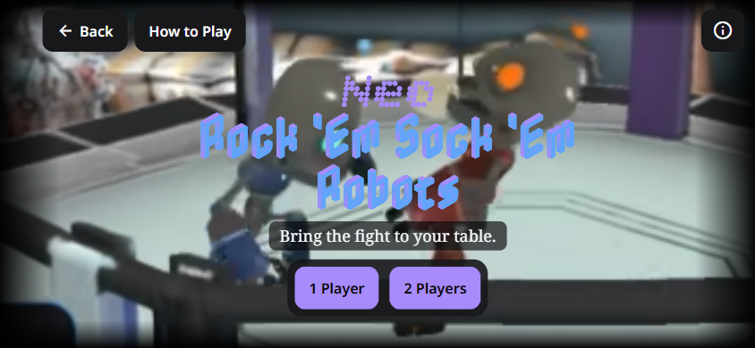
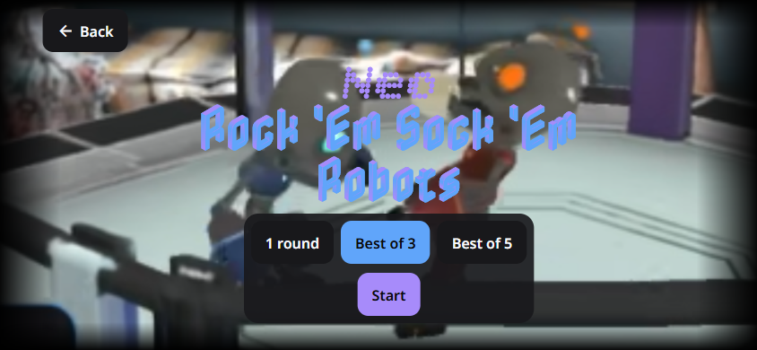
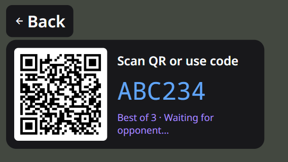
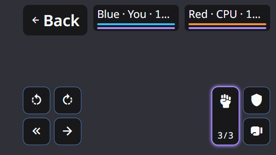
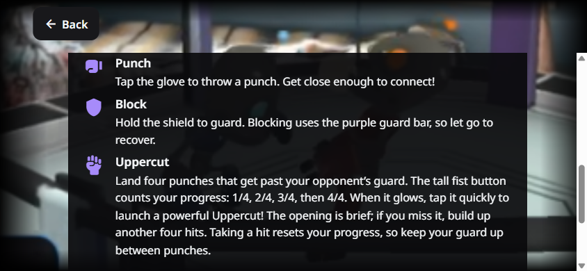
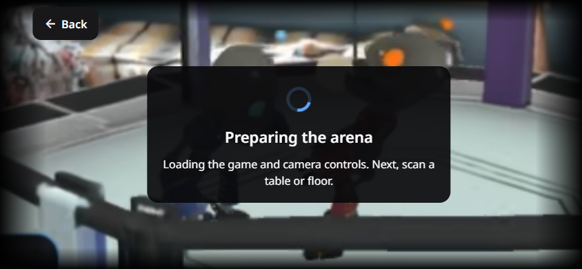

# Neo Rock 'Em Sock 'Em Robots UI refresh

Implemented in `xr-showcase-phase-2-arena` on October 10, 2026, preserving the existing combat, fitted contact, defense, animation and networking changes in this worktree.

## Player-facing changes

- Arena menus use the supplied background, a centered cover crop and an 8% edge vignette. Nabla retains dimensional lettering in blue/purple; Bitcount Ink contours use `slnt=-8`. Bundled static Noto fonts are scoped to Arena. Font licenses, source hashes and the offline regeneration helper are documented in `assets/arena/ui/README.md`.
- Placement, capture, alignment and loading show the top-left Back control and a bottom-right guidance pill. Setup actions become available after placement/loading and, for multiplayer, both phones' capability gates pass. Home, animation previews and FPS displays are removed from the HUD.
- Setup uses a compact bottom bar. Transform and Position remain on the right at 280 dp, without editor headings, measurements or Done buttons. Back steps through Position, Transform and controls before exiting to the Arena title menu. Other experiences retain the shared controls' existing defaults.
- Combat retains the existing raw touch handlers, independent fingers, held movement/block, accepted-input feedback and Uppercut glow. Seven icon targets measure up to 56 dp with a 44 dp minimum. Punch progress is inside Uppercut; health and guard bars appear at the top only during combat.
- Host capture automatically starts room creation once its existing quality gates pass. The controller prevents duplicate hosting, guards inactive/portrait starts and stale generations, and requires explicit Retry after failure. Invites use a fixed, unscrolled QR/code layout with 12 dp white padding.
- Multiplayer requires fresh Ready presses from both players before each round; results persist until that happens. Solo retains automatic progression. Countdown lettering shows Round X, then Ready; Fight! appears briefly at combat start. Results use the local player's score first, and draws replay the same numbered round.
- Solo players and hosts can transform finished matches without losing placement. Opening or adjusting the editor invalidates readiness; results hide while editing and return on Back.
- Exiting through the AR boundary releases camera ownership before the Arena exit callback. HUD Back disposes room operations, networking and the match before returning to the title menu. The portrait cover ends the active camera session and uses Back consistently.

## Protocol compatibility

The worktree already contained protocol 7 for the ongoing contact/counterplay work. Per-round readiness advanced it to 8, and the round-versus-match celebration follow-up advanced it to 9. The three-hit Uppercut rule now uses **protocol 10** so both phones agree on when the attack becomes available. Both phones must use this build; older invitations are rejected. Route and deep-link paths stay unchanged.

## Validation

- `npm test`: lint and Prettier pass; typecheck passes; **300 Arena, 14 AR, 108 Qubit and 23 Medical tests pass**.
- `npm run build:ios`: export succeeds, including the bundled Noto fonts and menu image.
- Offline font regeneration succeeds with cached pinned sources. SVG coordinate rounding was checked against complete path coordinates after the preview exposed a distortion in the initial helper.
- Native components were rendered through React Native Web for visual inspection. Reviewed the supplied background/vignette, corrected display lettering, scan-only chrome, combat geometry, centered results and complete invites at 568×320 and 844×390. The small invite was checked with the safe-area inset on either side and at 2× text scaling; its QR and code remained visible. These previews substitute the SVG, camera and native slider adapters and are **not native device verification**.
- Phone checks remain: real camera placement taps, native SVG appearance/performance, Expo UI editor sliders, simultaneous touches and a two-phone room/round/rematch run. An iOS export does not establish native runtime behavior.

## Menu follow-up

- Both player actions and the solo Start action now use the secondary purple. Selected round counts retain blue.
- The long Nabla line uses direct glyph paths, transparent SVG containers and solid fills for zero-length gradients. This removes shared native paint state and invalid gradient input while preserving the dimensional outlines and blue/purple palette. The tagline keeps its original backing.
- Updated title and solo previews show transparent title lettering over the artwork and matching action colors. These use the native components through React Native Web with SVG/image adapters; native rendering still needs a phone check.
- Follow-up validation: lint, typecheck, all 300 Arena tests and iOS export pass.

## Controls and native title correction

- Removed the redundant round-count heading on solo and host setup menus. Swap Sides and Transform use secondary purple; Restart AR uses muted red (`#d99a9a`) in the action bar and recovery guidance.
- Arena's Position action uses the same `ArenaButton` component as the main row, with primary blue and a 12 dp corner radius. Shared AR editors accept an optional custom Position control and retain their existing control by default.
- The phone screenshot `IMG_3663.png` exposed a cause the browser preview did not reproduce: empty Nabla space-glyph paths still had gradient fills. On iOS those paints can bypass glyph clipping and fill the SVG canvas, covering every letter drawn before the last space. Removed six empty paint nodes from the title and ten from the Round 1–5 assets, and updated the offline generator to omit them. The letter contours, gradients and spacing remain intact.
- The regression asserting that every Nabla phrase has no empty path failed against the old assets and passes with the correction. Lint, typecheck, all 300 Arena tests, 14 AR tests and iOS export pass. The updated title assets still require confirmation on the phone.

## Celebrations, combat columns and menu help

- Ordinary round victories play one CalibrationStretches sequence after the loser settles. Match victories, including every one-round match, retain two stretches followed by VictoryUppercut. The host decides the celebration at knockout time and includes that choice in protocol 9. Renderer acknowledgments, delayed guests and camera remounts retain their existing gates; solo rounds still advance automatically.
- Uppercut is the tall left column of the attack group, with Punch and Block on the right. It uses the approved free Font Awesome upward fist at the top and the punch-progress counter at the bottom, without an arrow overlay. Movement stays on the left side of the screen. Target sizes, multi-touch input, held movement/block, availability and glow remain intact.
- The title page has Back followed by How to Play at the top left, with the information-circle action aligned at the top right. All keep the same dark button treatment. Both help actions open Arena pages and Back returns to the title, including the orientation-cover Back path. The guide explains setup, all controls, earning Uppercut, its short window, progress resets on a hit, and winning rounds without implementation terminology.
- About the game explains anchored AR and shared-space play. Linked credits include David J. Grimsley as game developer, Tacko3D's Radical Robots — Mike pack, S1gnal for sound effects, Dire Black Audio for music, ViroReact/ReactVision, Expo and the icon libraries. The scrolling viewport stays below the persistent Back button at larger text sizes.
- Validation: lint/Prettier, typecheck, **312 Arena tests**, **14 AR tests**, and iOS export pass. Coverage includes both winners in best-of-three/five multiplayer matches, ordinary versus final celebrations, delayed presentation, remounts, protocol validation, tall-button geometry and both help-page Back routes.
- Refreshed component previews cover 844×390 and 568×320, both landscape inset arrangements, and 2× text scaling. Checked all seven external credit links and the full Uppercut explanation. These are React Native Web visual adapters, not native phone verification. Phone checks remain for the shorter rendered celebration, real touch delivery, camera behavior and two-phone play.
- Header placement correction: removed the obsolete left-side title reserve, restoring the centered title on small screens. Verified the top row has no overlapping buttons in both landscape orientations at normal and 2× text size. Lint, typecheck, all 312 Arena tests and iOS export pass after this correction.

## Startup loading and music credit

- The black screen in `IMG_3666.png` was the bare Suspense fallback while the deferred AR game module loaded, before camera startup. It had no full-screen layout, defaulted to a small spinner, and offered no message or Back action.
- Added an Arena loading screen with the menu artwork/vignette, a large blue indicator, a dark centered card and persistent top-left Back. Game startup says “Preparing the arena” and “Loading the game and camera controls. Next, scan a table or floor.” Menu typography, multiplayer connection checks and QR-scanner startup each use their own message. Solo startup no longer describes itself as a multiplayer connection check.
- Back disposes a pending game controller or cancels the connection check, with regressions for a late connection result and deferred game/scanner cancellation. Large text can scroll below Back; normal 568×320 and 844×390 layouts keep the complete message visible.
- Dire Black Audio's music credit now points to `https://www.direblackaudio.com/`.
- Validation: lint/Prettier, typecheck, **314 Arena tests** and iOS export pass. Reviewed loading component previews at both landscape inset arrangements and 2× text size. Real native startup timing and spinner appearance still need a phone check.

## Full menu titles and three-hit Uppercut

- Round selection and multiplayer join use the same title size as the title menu. Removed the join caption to give the title and invite controls more room. All menus retain the same responsive reduction on short viewports.
- Three landed, unblocked punches now earn Uppercut for players and the CPU. The button and accessible progress use the shared rule, and How to Play explains the `1/3`, `2/3`, `3/3` progression. Punch and Uppercut damage remain 8 and 15 HP; three punches followed by an Uppercut deal 39 HP.
- Protocol 10 rejects older peers and invalid four-hit progress. Both phones need the updated build.
- Validation: lint/Prettier, typecheck, **314 Arena tests** and iOS export pass. Component previews confirm equal title sizes on the title, solo, host and join pages at 844×390, visible controls at 568×320 with either landscape inset arrangement, and the `3/3` combat counter at large text size. Native appearance and two-phone play still require a phone check.
